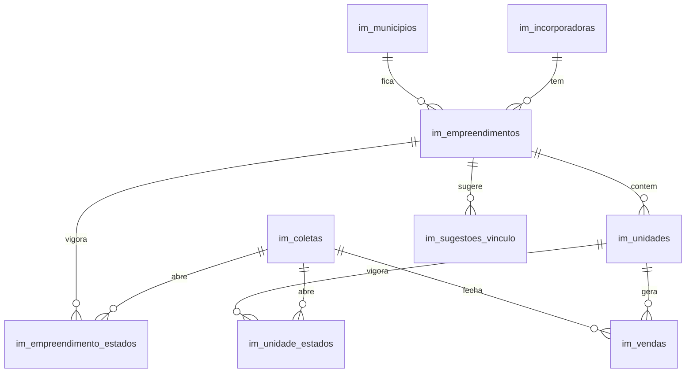

# Monitor de Mercado da BKM

Coleta e armazenamento de empreendimentos residenciais em São Paulo e São José dos Campos. O dado é da BKM inteira: não há empresa, não há schema `app` e não há tabela do BKM Terrenos. O BKM Terrenos só lê estas tabelas depois.

Fase 1 grava unidade por unidade, com `preco_primeiro`, vigência de preço e situação, e a venda no fechamento da mensal completa. Não há vista nem função de velocidade, estoque, grupo ou lançamento. A leitura é direta nas tabelas, pela API REST do Supabase.



## Banco

As migrations ficam em `supabase/migrations/`. As tabelas `im_*` nascem no schema `public`, com RLS:

- `authenticated` só faz `select`;
- escrita pelas funções `im_*` security definer, com `execute` só para `service_role`;
- `anon` não lê nem escreve.

O JSON bruto vai para o bucket privado `im-bruto`. A migration não altera objeto de outro sistema. O teste `supabase/tests/atlas_antes.sql` cria tabelas, função, publication e políticas `atlas_*`, aplica as migrations e confere que nada disso mudou.

```bash
bash supabase/tests/run.sh
```

Precisa do Postgres 16 (`postgresql-16`). Não aplica nada num Supabase remoto.

## Coletor

```bash
cd tools/coletar
pip install -e ".[teste]"
python -m pytest -q
```

Variáveis da rodada:

| Variável | Uso |
| --- | --- |
| `ORULO_EMAIL`, `ORULO_PASSWORD` | Login do `orulo_login` |
| `SUPABASE_URL`, `SUPABASE_SERVICE_ROLE_KEY` | API do Supabase, papel `service_role` |
| `ORULO_CLIENT_ID`, `ORULO_CLIENT_SECRET` | Opcionais. Só o esqueleto `orulo_api` |
| `ORULO_ATRASO_MIN`, `ORULO_ATRASO_MAX` | Opcionais. Padrão 2 e 3 segundos |
| `COLETAR_TIPO` | No cron: `mensal` ou `lancamentos` |

Não existe `EMPRESA_ID`. O detalhe do comando, da planilha e dos dois crons está em [docs/coletar.md](docs/coletar.md).

Vendas, dia 1 às 03:00 em São Paulo: `tools/coletar/railway.mensal.json`, cron `0 6 1 * *`. Lançamentos, segunda no mesmo horário: `tools/coletar/railway.lancamentos.json`, cron `0 6 * * 1`. Os arquivos estão prontos para um projeto Railway próprio. Este repositório não faz o deploy.

## Como o BKM Terrenos lê

A chave do front é a do usuário (`authenticated`), nunca a `service_role`. `anon` recebe erro de permissão. Exemplos na API REST (`Accept-Profile` não é necessário: as tabelas estão em `public`):

```http
GET /rest/v1/im_empreendimentos?select=id,nome,bairro,situacao,latitude,longitude,origem,ativo&ativo=eq.true
```

```http
GET /rest/v1/im_unidades?select=id,empreendimento_id,torre,numero,area_privativa_m2,dormitorios,vagas,preco_primeiro,preco_de_lancamento,residencial&residencial=eq.true&removida_coleta_id=is.null
```

```http
GET /rest/v1/im_unidade_estados?select=unidade_id,situacao,preco,preco_original&ate_coleta_id=is.null
```

```http
GET /rest/v1/im_vendas?select=unidade_id,coleta_id,vendida_de,vendida_ate,preco,origem_preco,antes_do_monitor&desfeita_coleta_id=is.null
```

```http
GET /rest/v1/im_incorporadoras?select=id,nome,cnpj,ativo&ativo=eq.true
```

Cabeçalhos: `apikey` com a chave publicável do projeto e `Authorization: Bearer` com o JWT do usuário. O filtro e a conta (velocidade, preço por m², grupo) ficam para quem lê. `preco_primeiro` não muda, então o mesmo agrupamento pode ser refeito mês a mês sem reprocessar a coleta.
