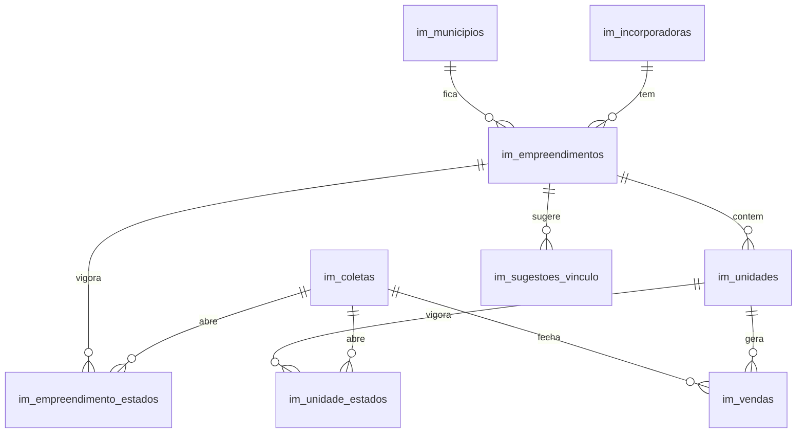

# Monitor de Mercado da BKM

Coleta e armazenamento de empreendimentos residenciais em São Paulo e São José dos Campos. O dado é da BKM inteira: não há empresa, não há schema `app` e não há tabela do BKM Terrenos. O BKM Terrenos só lê estas tabelas depois.

Fase 1 grava unidade por unidade, com `preco_primeiro`, vigência de preço e situação, e a venda no fechamento da mensal completa. Não há vista nem função de velocidade, estoque ou lançamento sobre as unidades coletadas; o VSO histórico vem do relatório do Órulo (abaixo). A leitura é direta nas tabelas, pela API REST do Supabase.




## Resumo do empreendimento (grupos)

Desde 4/nov/2026 o banco agrupa as unidades de cada empreendimento em tipologias parecidas, só na leitura (nada do que foi coletado muda). Regra do Moisés, descrita no topo de `supabase/migrations/20261104120000_grupos.sql`: mesmos dormitórios, vagas e programa social; área por mediana iterativa a partir da planta-tipo; R$/m² do `preco_primeiro` com saltos no mesmo andar e entre andares; grupo pequeno só junta a um que difere apenas na área. Limites em `im_mercado_config`.

- `im_grupos`: o grupo, com as faixas de área e de R$/m² de quando nasceu; `encerrado_em` quando reagrupado.
- `im_unidade_grupos`: o grupo de cada unidade, com `desde` e `ate` (vigente = `ate` nulo). Unidade já agrupada não muda de grupo.
- `im_agrupar(p_emp)`: agrupa as unidades ainda sem grupo (as novas entram no grupo aberto que as comporta; as outras passam pela regra só entre elas). O coletor chama ao fim de cada rodada.
- `im_reagrupar(p_emp)`: encerra os grupos e refaz tudo; a venda antiga fica com o grupo da época (a ligação vigente na data da coleta que a gravou).

## Histórico mensal do Órulo (VSO de dez/2023 a out/2026)

Carga única do relatório "variação 36 meses" que a Órulo entregou à BKM em nov/2026 (decisão do Moisés, 12/nov/2026). Migration `20261112220000_historico_orulo.sql`.

- `im_historico_orulo`: um registro por empreendimento do Órulo por mês, com unidades, estoque no fim do mês, vendas e distratos das tipologias residenciais. Guardado pelo número do Órulo (o de `im_ids_externos`), sem chave para `im_empreendimentos`: quem o monitor ainda não coleta passa a valer quando entrar. Nada do que o monitor coletou muda.
- `im_vso_historico(p_emp)`: só leitura, aberta a `anon` como a `im_tabela_empreendimento`. Devolve a série mensal, as janelas de 1, 3, 6 e 12 meses e do período todo, os trimestres, semestres e anos e o geral do projeto (vendido ÷ unidades e a média por mês desde o lançamento), com `completo` quando o histórico começa no lançamento.
- VSO = vendas líquidas ÷ (vendas líquidas + estoque no fim do período), a mesma leitura do monitor. A venda do Órulo é a unidade que saiu da tabela; recarga de tabela vira distrato num mês e venda no seguinte e se anula na líquida. Período com mais distrato que venda fica sem VSO. O VSO pronto do relatório (vendido acumulado ÷ meses) não é usado.
- Limites do relatório: sem programa social (vem do monitor), quase nada de São José dos Campos (7 empreendimentos), e o empreendimento lançado antes de dez/2023 não tem a distribuição das vendas anteriores (o geral continua exato).

Carga: `tools/historico_orulo/ler_xlsx.py` e `montar.py` geram o CSV, importado na tabela pelo Table Editor do Supabase.

## Banco

As migrations ficam em `supabase/migrations/`. As tabelas `im_*` nascem no schema `public`, com RLS:

- `authenticated` só faz `select`;
- escrita pelas funções `im_*` security definer, com `execute` só para `service_role`;
- `anon` não lê nem escreve.

O JSON bruto vai para o bucket privado `im-bruto`. A migration não altera objeto de outro sistema. O teste `supabase/tests/atlas_antes.sql` cria tabelas, função, publication e políticas `atlas_*`, aplica as migrations e confere que nada disso mudou.

```bash
bash supabase/tests/run.sh
```

Precisa do Postgres 16 (`postgresql-16`). Não aplica nada num Supabase remoto.

## Coletor

```bash
cd tools/coletar
pip install -e ".[teste]"
python -m pytest -q
```

Variáveis da rodada:

| Variável | Uso |
| --- | --- |
| `ORULO_EMAIL`, `ORULO_PASSWORD` | Login do `orulo_login` |
| `SUPABASE_URL`, `SUPABASE_SERVICE_ROLE_KEY` | API do Supabase, papel `service_role` |
| `ORULO_CLIENT_ID`, `ORULO_CLIENT_SECRET` | Opcionais. Só o esqueleto `orulo_api` |
| `ORULO_ATRASO_MIN`, `ORULO_ATRASO_MAX` | Opcionais. Padrão 2 e 3 segundos |
| `COLETAR_TIPO` | `mensal` ou `lancamentos` quando o comando não traz `--tipo` |

Não existe `EMPRESA_ID`. A semanal de lançamentos só varre a listagem e abre, um a um, o empreendimento que ainda não está no banco (detalhe e unidades). `--id` recolhe um ou mais empreendimentos sem essa varredura. O detalhe do comando, da planilha e dos dois jobs está em [docs/coletar.md](docs/coletar.md).

Vendas (`coleta-mensal`), dia 1 às 00:10 em São Paulo (`10 0 1 * *`), e lançamentos (`coleta-lancamentos`), segunda às 06:00 (`0 6 * * 1`), são jobs do Cloud Run no projeto `bkm-monitor`, região `southamerica-east1`, sem argumentos no container. O tipo vem de `COLETAR_TIPO` e a data é o dia da execução em `America/Sao_Paulo`. Montagem e o comando de teste em [docs/cloud-run.md](docs/cloud-run.md). Este repositório não faz o deploy.

## Como o BKM Terrenos lê

A chave do front é a do usuário (`authenticated`), nunca a `service_role`. `anon` recebe erro de permissão. Exemplos na API REST (`Accept-Profile` não é necessário: as tabelas estão em `public`):

```http
GET /rest/v1/im_empreendimentos?select=id,nome,bairro,situacao,latitude,longitude,origem,ativo&ativo=eq.true
```

```http
GET /rest/v1/im_unidades?select=id,empreendimento_id,torre,numero,area_privativa_m2,dormitorios,vagas,preco_primeiro,preco_de_lancamento,residencial&residencial=eq.true&removida_coleta_id=is.null
```

```http
GET /rest/v1/im_unidade_estados?select=unidade_id,situacao,preco,preco_original&ate_coleta_id=is.null
```

```http
GET /rest/v1/im_vendas?select=unidade_id,coleta_id,vendida_de,vendida_ate,preco,origem_preco,antes_do_monitor&desfeita_coleta_id=is.null
```

```http
GET /rest/v1/im_incorporadoras?select=id,nome,cnpj,ativo&ativo=eq.true
```

Cabeçalhos: `apikey` com a chave publicável do projeto e `Authorization: Bearer` com o JWT do usuário. O filtro e a conta (velocidade, preço por m², grupo) ficam para quem lê. `preco_primeiro` não muda, então o mesmo agrupamento pode ser refeito mês a mês sem reprocessar a coleta.
